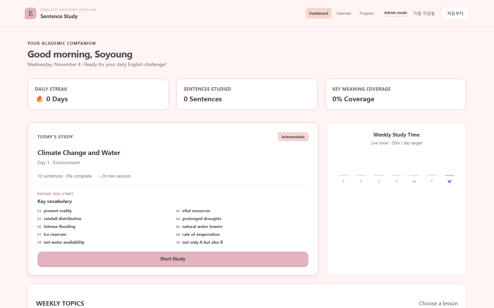
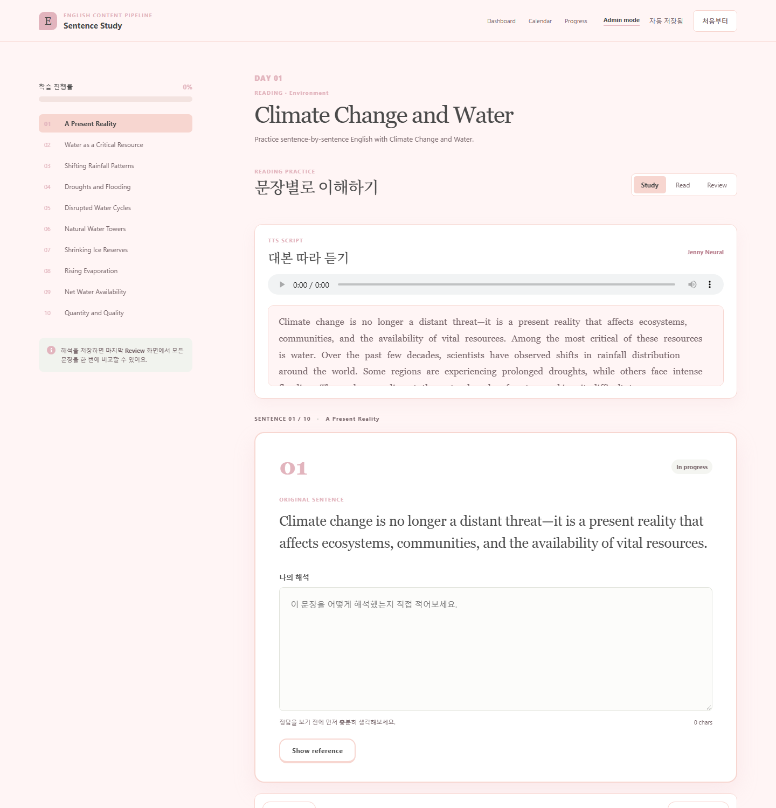
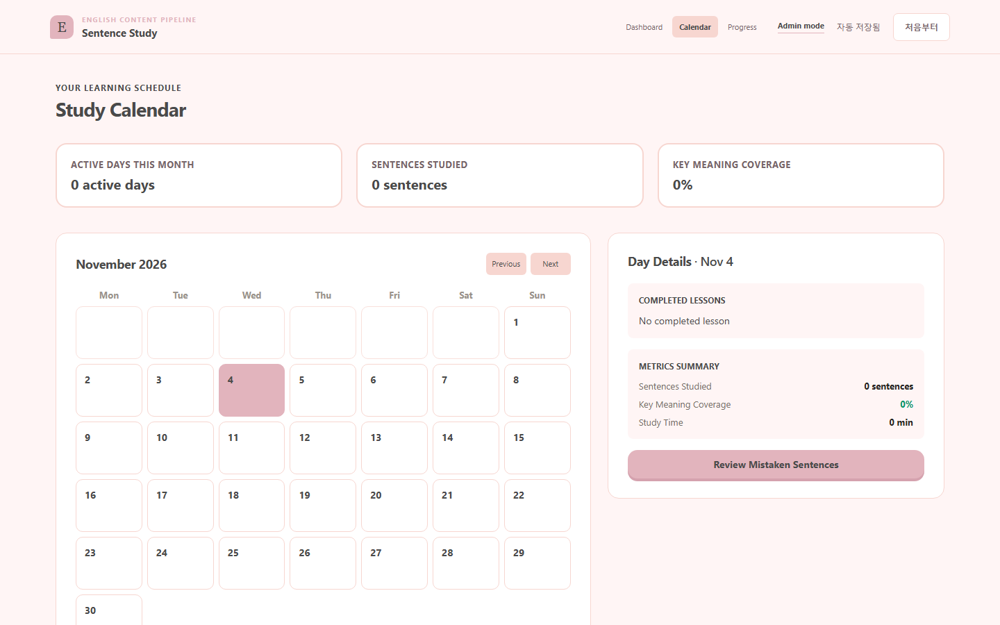
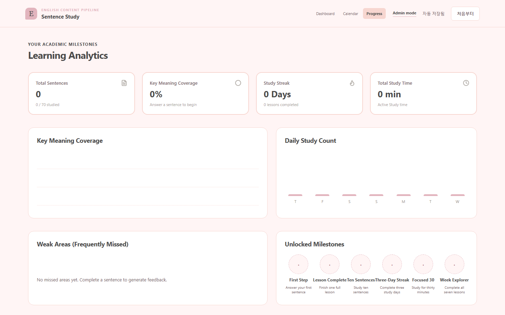
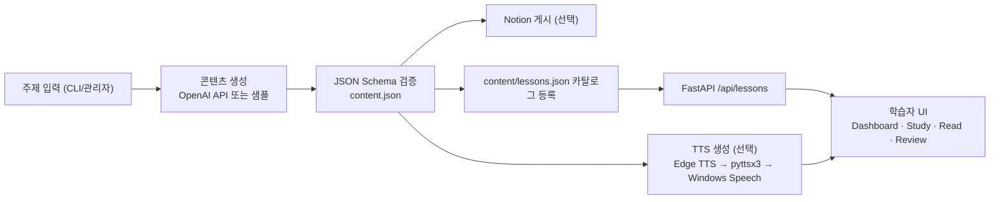

# English Content Pipeline

<p align="center">
  
  
  
  
  
</p>

주제나 원문을 넣으면 **구조화된 학습 콘텐츠(JSON) → Notion 게시 → 음성(TTS) → 학습자 UI**까지 한 번에 이어지는 영어 학습 콘텐츠 자동화 파이프라인입니다. LLM API 없이도 사용자가 준비한 원문으로 전체 흐름을 돌릴 수 있습니다.

## 무엇을 만들었나

| | |
| --- | --- |
| **문제** | 영어 학습 콘텐츠를 만들 때마다 원문 작성·문장별 해석·오디오 녹음·학습 화면 등록을 따로 손으로 반복해야 했고, `content/*.json`과 학습자 UI의 샘플 데이터를 이중으로 갱신해야 했습니다. |
| **해결** | 주제 또는 원문을 CLI/관리자 화면에 넣으면 JSON Schema로 검증된 `content.json` 하나를 만들고, 같은 파일을 Notion 게시·TTS 생성·학습자 UI가 그대로 재사용합니다. 유료 TTS 없이 Edge Neural TTS를 우선 쓰고 실패하면 로컬 음성 엔진으로 넘어가는 3단 fallback을 넣었습니다. |
| **규모** | 레슨 7개, 테스트 18개 전부 통과, 커밋 6개 |
| **개발** | 1인 개발 · 2026-08-23 ~ 2026-08-30(약 1주) · 기획·백엔드·관리자 UI·학습자 UI 전부 |
| **상태** | 로컬 실행 프로토타입, 공개 배포 없음 |

## 화면

학습 기록이 없는 초기 상태에서 `uvicorn`으로 띄운 화면을 캡처했습니다(1440px 너비).

| Dashboard | Study |
| --- | --- |
|  |  |
| **Calendar** | **Progress** |
|  |  |

## 어떻게 동작하는가



학습자 화면은 하나의 소스만 봅니다: `content/*.json → FastAPI /api/lessons → ui/app.js fetch() → Dashboard/Study/Read/Review`. 레슨을 추가할 때 `content/lessons.json`에 카탈로그 항목만 등록하면 UI 코드를 고치지 않고 반영됩니다.

## 기술적 도전과 해결

**1. 유료 TTS 없이 안정적으로 음성을 만들어야 했던 문제**

단어별 발화 타이밍(`audio_cues.json`)까지 포함한 음성이 필요했지만 유료 API는 쓰지 않기로 했습니다. Edge Neural TTS를 먼저 시도해 단어별 cue까지 받고, 실패하면 `pyttsx3`로, 그래도 실패하면 Windows Speech API(SAPI)로 넘어가는 3단 fallback을 `LocalTTSGenerator`에 구현했습니다(`src/generators/tts_generator.py`). 다만 pyttsx3·SAPI로 넘어가면 MP3는 만들어지지만 단어 동기화 정보는 생성되지 않는다는 점을 README에 그대로 밝혀 뒀습니다.

**2. LLM 생성 결과가 다운스트림에서 깨지지 않게 하는 문제**

같은 `content.json`을 Notion 게시·TTS·학습자 UI·관리자 Publish가 모두 재사용하므로, 생성 단계의 출력이 조금만 어긋나도 뒤쪽 전부가 깨질 수 있었습니다. `src/models/content.py`의 `validate_content`로 JSON Schema를 통과한 결과만 저장·재사용하게 했고, 관리자 Publish도 같은 검증을 통과해야 `content/{lesson-id}.json`과 카탈로그에 등록됩니다.

**3. 콘텐츠와 UI 샘플 데이터의 이중 등록 문제**

초기 버전은 `content/*.json`을 늘릴 때마다 `ui/app.js`의 샘플 학습 데이터도 손으로 맞춰야 했습니다. FastAPI `/api/lessons`·`/api/lessons/{lesson_id}`를 추가해 카탈로그 메타데이터와 레슨 본문을 API로 단일화하고, `loadLessons()`/`normalizeLesson()`이 이를 UI 모델로 연결하도록 바꿔 이중 등록을 없앴습니다.

## 구조·스택 선택 이유

- **FastAPI를 콘텐츠의 단일 소스로.** 정적 `python -m http.server`는 `/api/lessons`를 제공하지 못하므로, 학습자 화면과 관리자 화면 모두 FastAPI 하나를 거치게 해 콘텐츠 갱신 경로를 하나로 유지합니다.
- **생성 경로와 TTS 경로를 분리.** OpenAI API가 없어도 `--sample`이나 사용자 제공 원문(`--content-file`)으로 전체 흐름을 돌릴 수 있고, TTS도 유료 API 없이 3단 fallback으로 동작합니다. 비용 없이 반복 테스트할 수 있게 하기 위한 선택입니다.
- **학습 진행도는 서버가 아니라 `localStorage`.** 별도 DB 없이 학습자 기기에 해석 입력과 진행도를 저장해, 프로토타입 단계에서 백엔드 상태 관리를 늘리지 않았습니다.

## 실행

```bash
# API 없이 샘플 데이터로 전체 흐름 테스트
python -m src.main --topic "Climate Change and Water" --sample

# 사용자가 제공한 콘텐츠로 API 없이 실행
python -m src.main --content-file content/digital_minimalism.json

# OpenAI API로 실제 콘텐츠 생성 (.env.example을 .env로 복사 후 OPENAI_API_KEY 설정)
python -m src.main --topic "Climate Change and Water"

# 전체 UI(관리자 포함)를 API와 함께 실행
uvicorn src.api:app --host 127.0.0.1 --port 8001
```

학습자 화면은 `http://127.0.0.1:8001/`, 관리자 화면은 `http://127.0.0.1:8001/admin`에서 엽니다.

```bash
python -m unittest discover -s tests -v
```

## 한계

- 번역 피드백은 LLM 평가가 아니라 키워드/규칙 기반 `Key Meaning Coverage`입니다(`TASKS.md`에 명시). LLM 기반 번역 리뷰어는 아직 없습니다.
- TTS가 Edge Neural 단계를 넘어 pyttsx3·Windows Speech로 넘어가면 단어별 발화 타이밍 정보가 생성되지 않습니다.
- OpenAI API 키가 없는 환경에서는 관리자 Generate가 local sample 모드로만 동작합니다.
- 관리자 화면에 별도 인증이 없습니다.
- 공개 배포 없이 로컬 실행만 검증했습니다.
